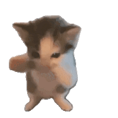

<!-- ═══════════════════════ HEADER ═══════════════════════ -->
<p align="center">
  
  
  
</p>

<p align="center">
  <a href="https://github.com/roosaramendis">
    
  </a>
</p>

<p align="center">
  
  <a href="https://discord.gg/cXxv2KtP"></a>
  <a href="https://x.com/roosaramendis"></a>
</p>

<p align="center">
  
  
  
  
  
</p>

---

## 🌸 AH LE LE?! A wild traveler appeared!

> *Ayo, you just entered my lore. Grab a snack, the render's gonna take a while* ✧˖°(◕‿◕✿)

```yaml
# ✦ CHARACTER STATS ✦  (press X to doubt)
name:           Roosara Mendis
class:          3D Artist / 2D Artist / VFX Mage
subclass:       Hobby Programmer · Game Dev · Certified Linux Enjoyer
rank:           S-tier  # self-proclaimed, no cap
aura:           +9999
main_weapons:   [Blender, Unreal Engine 5, Nuke, DaVinci Resolve]
side_weapons:   [C++, C#, Python, Qt]
current_arc:    "Indie Film Arc"  # 0 filler episodes, all bangers
ultimate:       "Ctrl+S Every 3 Seconds no Jutsu"
weakness:       [render times, sleep schedule, "just one more tutorial"]
status_effect:  "cooked 💀 but still locked in"
```

---

## 📜 Main Character Quest Log

- 🎬 **Main Story Arc** — making my own BS
- 🐧 **Side Quest** — bullying software into working on Linux
- 🪟 **Side Quest** — bullying Microslop
- 🐉 **Daily Quest** — make art → break things → fix things → watching p**n → repeat *(the cycle of reincarnation)*

---

## ⚔️ Skill Tree (Ultimates Unlocked)

**🖌️ Art & VFX Magic** — *my actual power source*

<p align="left">
  
  
  
  
  
</p>

**💻 Code Jutsu** — *hobby mode, but make it sigma*

<p align="left">
  <a href="https://skillicons.dev">
    
  </a>
</p>

---

## 🚩 Red Flags (fr fr)

- Says *"it's just a quick render"* — it is **never** a quick render
- Has more `final_FINAL_v7_ACTUALLY_final.blend` files than friends
- Gets isekai'd into any rabbit hole that has a GitHub repo
- Believes in the power of `Ctrl+Z`

---

## 🏆 Achievements Unlocked

| Achievement | Rarity |
|---|---|
| 🔥 Survived a whole UE5 session without crashing | ✨ Legendary *(happened once)* |
| 🍝 Untangled a node graph that looked like spaghetti | 💜 Epic |
| 🐧 Ported Windows-only stuff to Linux out of pure spite | 💜 Epic |
| 💀 Accidentally rendered 2000 frames at 8K | 🩷 Cursed |
| 🌱 Touched grass | ❌ 404 Not Found |

---

## 🖼️ Art Gallery (the real lore drops here)

> *Go look, it's giving masterpiece* ✨

<p align="left">
  <a href="https://www.artstation.com/roosaramendis"></a>

</p>

---

## 📡 Summon Me (No Gacha Pulls Required)

<p align="left">
  <a href="mailto:sydrac3d@duck.com"></a>
  <a href="https://discord.gg/cXxv2KtP"></a>
  <a href="https://x.com/roosaramendis"></a>
  <a href="https://instagram.com/roosaramendis"></a>
  <a href="https://www.linkedin.com/in/LINKEDIN_SLUG"></a>
  <a href="https://www.facebook.com/FACEBOOK_SLUG"></a>
</p>

---

## 📊 Aura Level Scanner

> *Scouter says... IT'S OVER 9000!!* ...probably ( •̀ ω •́ )✧

<p align="center">
  
  
</p>

<p align="center">
  
</p>

<p align="center">
  
</p>

---

## ☕ Save This Crazy Idiot

> *Every coffee = +1 render frame and +50 aura* (っ˘ω˘ς)

<p align="left">
  <a href="https://www.buymeacoffee.com/roosaramendis">
    
  </a>
</p>

---

## 🐍 Snake Eating My Commits (Ohio Edition)

<p align="center">
  <picture>
    <source media="(prefers-color-scheme: dark)" srcset="https://raw.githubusercontent.com/roosaramendis/roosaramendis/output/github-snake-dark.svg" />
    <source media="(prefers-color-scheme: light)" srcset="https://raw.githubusercontent.com/roosaramendis/roosaramendis/output/github-snake.svg" />
    
  </picture>
</p>

<p align="center">
  <b>Bye bye~ you're officially part of the lore now</b> ✨ (≧▽≦)<br/>
  <i>stay sigma · stay hydrated · touch grass (I won't)</i>
</p>

<p align="center">
  
</p>